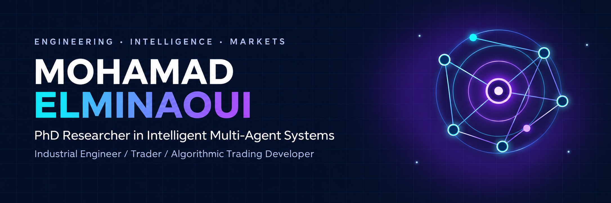

  

### PhD Researcher - Industrial Engineer - Trader & Algorithmic Trading Developer

**I enjoy building intelligent systems that turn complex problems into practical decisions.**

---

### A little about me

Hi, I'm Mohamad. I'm an industrial engineer currently pursuing a **PhD in France**, where I study **intelligent multi-agent systems** and how autonomous agents can coordinate, negotiate and make decisions when the environment is uncertain.

I enjoy working at the intersection of mathematics, engineering and software. What interests me most is understanding how a system behaves, especially when things don't go according to plan, and finding ways to make its decisions more reliable.

I have two master's degrees, one in **Industrial Engineering** and another in **Supply Chain and Transport**.

I'm also a **trader** with a strong interest in algorithmic trading. I like turning trading ideas into code, testing them against historical data and learning what still works when realistic costs and risk are included.

### What I'm working on

<table>
<tr>
<td width="50%" valign="top">

**🧠 Intelligent Multi-Agent Systems**

My PhD research explores how autonomous agents interact and coordinate. I'm especially interested in trust, negotiation and what happens to those relationships when supply chains face disruptions.

</td>
<td width="50%" valign="top">

**📈 Dear Bruce | Algorithmic Trading**

Dear Bruce is my personal trading research and development project. I use it to explore systematic strategies, build backtesting tools and evaluate ideas with a focus on execution and risk management.

</td>
</tr>
<tr>
<td width="50%" valign="top">

**🤖 Reinforcement Learning and Optimization**

I explore how learning and optimization methods can help solve industrial decision problems, including human-robot collaborative disassembly line balancing.

</td>
<td width="50%" valign="top">

**⚙️ Intelligent Systems Development**

I enjoy working with Python, agent architectures, simulations and decision-support tools. I like taking an idea from research and finding out how it performs in a working system.

</td>
</tr>
</table>

### Tools and technologies

**Topics I keep exploring**

`Multi-Agent Systems` · `Reinforcement Learning` · `Operations Research` · `Optimization`  
`Simulation` · `Agent Orchestration` · `Algorithmic Trading` · `Backtesting`

### How I approach problems

I care about more than getting a good result once. I want to understand why something works, test whether it holds up under different conditions and keep improving it. That mindset guides both my research and my trading projects.

---

**Research · Build · Test · Improve**

[My GitHub](https://github.com/Menawi7)

Some of my research and development projects are still private while they are being prepared for public release.

